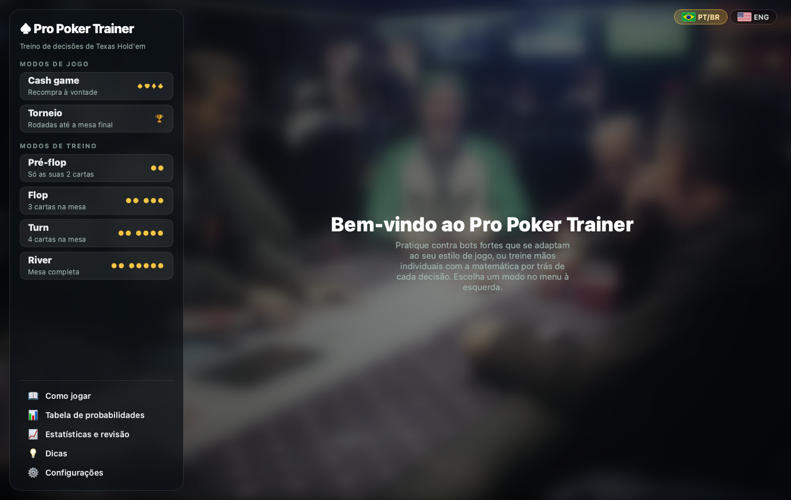
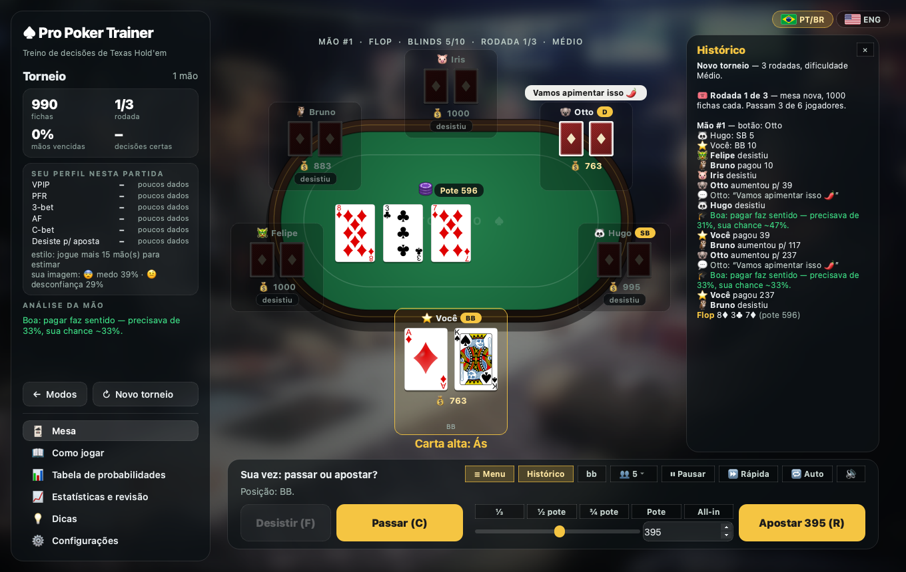
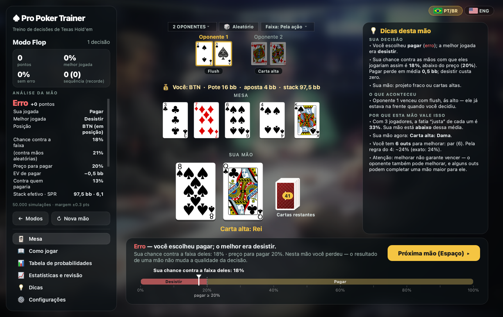

# Pro Poker Trainer

Treinador de decisões de Texas Hold'em No-Limit para macOS e Linux (Python + PySide6), em português e inglês.

Em cada mão de treino você vê suas cartas, a mesa e a situação de aposta e escolhe **Desistir**, **Passar/Pagar**
ou **Apostar/Aumentar**. O app calcula a sua chance real (por simulação), compara com o preço da aposta (pot odds)
e com o limite para apostar por valor, diz qual era a melhor jogada e explica por quê. Depois, dá para colocar tudo
em prática num cash game ou num torneio contra bots com personalidade.

## Telas

**Menu principal** — modos de jogo em cima, modos de treino embaixo e as páginas de apoio (Como jogar, tabela de
probabilidades, estatísticas, dicas e configurações).



**Torneio** — mesa de feltro verde, rodada e dificuldade no topo, status colorido de cada jogador (quem desistiu fica
apagado), histórico da mão e o seu perfil ao lado.



**Treino de decisões** — depois da jogada: a nota, a sua chance **contra a faixa de quem apostou** (e quanto seria
contra cartas aleatórias), a posição, o stack efetivo, o preço, o EV em bb e a explicação da mão.



## Como rodar

```bash
uv sync
uv run pokertrainer        # ou: uv run python -m pokertrainer
```

## Modos

O menu lateral mostra primeiro os **modos de jogo** (Cash game e Torneio) e, embaixo, os **modos de treino**
(Pré-flop, Flop, Turn e River).

| Modo      | O que é                                                                           |
|-----------|-----------------------------------------------------------------------------------|
| Pré-flop  | treino de decisão só com as suas 2 cartas                                          |
| Flop      | treino com 3 cartas na mesa                                                        |
| Turn      | treino com 4 cartas na mesa                                                        |
| River     | treino com a mesa completa                                                         |
| Cash game | partida completa (No-Limit, blinds 5/10, 1000 fichas) contra bots, com recompra    |
| Torneio   | rodadas eliminatórias até a mesa final, sem recompra                               |

**Páginas de apoio:** Como jogar, Tabela de probabilidades, Estatísticas, Dicas e Configurações têm um botão
**✕ Fechar** (ou Esc) que volta para onde você estava — a mesa do treino, a partida ou o início.

**Como jogar:** no menu lateral, uma página rolável com todas as regras — cartas, blinds, rodadas de apostas, ações,
ranking das mãos com exemplos, desempates, all-in e potes paralelos, e as regras de cada modo do app.

## Treino de decisões

**A situação** tem posição, stack efetivo (40 a 150 bb) e o que cada oponente fez — mostrado no assento de cada um
(ex.: "CO · apostou 8 bb"). Os valores aparecem em big blinds. Teclas: **F** desistir, **C** passar/pagar,
**R** apostar/aumentar, **Espaço**/**Enter**/**S** próxima mão.

- **Pré-flop:** *abrir* (todos desistiram até você — a posição define a faixa de abertura, do ~14% no UTG ao ~42% no
  botão), *contra um aumento* (você no botão ou no big blind, com quem aumentou e quem pagou) e *contra limpers*
  (você no big blind: passar ou isolar).
- **Depois do flop:** um pote de aumento pré-flop (você ou o oponente 1 aumentou), com as ruas anteriores já jogadas;
  ou passaram para você / você fala primeiro, ou o oponente 1 apostou e outros pagaram.
- **Tamanho:** ao apostar ou aumentar você escolhe o tamanho (⅓, ½, ⅔ ou pote; 2,5×, 3× ou all-in; 2,2–3 bb para
  abrir). A nota também olha o tamanho.

**As cartas dos oponentes saem das faixas de quem fez o que fez** — ninguém aumenta, aposta ou paga com qualquer mão.
Antes do flop a faixa vem da posição e da ação (abertura por posição, quem paga um aumento, quem só paga o big blind);
depois do flop cada combinação ganha peso pela classe da mão naquela mesa (dois pares+, par alto, par fraco, projeto
forte, projeto fraco, nada) e pela ação (apostou, pagou, passou). A sua chance é calculada contra essas faixas, por
Monte Carlo, e o app mostra também quanto seria contra cartas aleatórias, para comparar.

**A nota:**

- **Abrir:** pela tabela de aberturas da posição (no limite, abrir ou desistir são aceitáveis; entrar só pagando,
  nunca).
- **Pagar:** só se a chance contra a faixa de quem apostou passar do preço (*aposta ÷ pote final*). **Fora de
  posição** o preço sobe 4 pontos (você realiza menos da sua chance); **projetos fortes com stack fundo** ganham
  odds implícitas (5 pontos a menos).
- **Apostar/aumentar por valor:** só se você estiver à frente das **mãos que pagariam** (mais de 50% heads-up,
  42% multiway) — não basta estar à frente da faixa inteira. Re-aumento pré-flop (3-bet) com as mãos do topo.
- **Semiblefe:** projetos fortes no flop e no turn podem apostar; no river, um blefe pequeno em posição contra quem
  passou é aceitável.
- **Tamanho:** jogada certa com tamanho fora do recomendado vira "aceitável" (ex.: mão muito forte → ⅔ do pote ou
  mais; valor fino → ⅓ a ⅔; aumento de 2,5–3×; all-in com SPR baixo).

Cada decisão vale 100 pontos (melhor jogada), 40–70 (aceitável) ou 0 (erro). Depois da decisão, as cartas dos
oponentes e o resto da mesa aparecem; o medidor mostra a sua chance (ou a força da mão, na abertura) sobre as faixas
de cada jogada, e o painel ao lado explica a decisão, o que aconteceu nas cartas seguintes e por que a mão vale o que
vale.

**Oponentes e faixas:** acima das cartas, "N OPONENTES" escolhe de 1 a 9 oponentes, "🎲 Aleatório" sorteia o número
a cada mão e "Faixa" escolhe entre **Pela ação** (realista, o padrão) ou uma faixa fixa (qualquer mão, top
50/30/15/8%) que ignora a ação — útil para treinar o cálculo puro.

**Estatísticas e revisão:** pontos por decisão com média móvel, % de melhor jogada e de decisões sem erro, EV das
vezes em que você pagou, acerto por tipo de mão e as últimas decisões — dois cliques reabrem a mão na mesa para
revisar. "Treinar meu ponto fraco" (ou dois cliques num tipo de mão) distribui só mãos desse tipo até você clicar
no ✕. A tela inicial tem atalhos para o treino, o cash game e o torneio.

## Cash game e torneio

Mesa de feltro verde (com proporção fixa, centralizada em telas largas) com 1 a 9 bots; quem está na vez tem borda
amarela, e quem desistiu fica com nome e fichas apagados e as cartas escurecidas. Embaixo de cada jogador aparece a
última ação, colorida: **passou** em verde, **apostou/aumentou/all-in** em amarelo e **desistiu** em cinza. Você
desiste, passa/paga ou aposta/aumenta (atalhos ⅓, ½, ¾, pote, all-in; teclas F, C e R). A cada aposta que você
enfrenta, o app mostra as pot odds e, depois, se a decisão fez sentido (🎓 no histórico da mão) — comparando com a
sua chance **contra as faixas pela ação de cada bot nesta mão**, não contra mãos aleatórias. O assistente
(Configurações) mostra essa chance na sua vez. Há potes paralelos, recompra quando você quebra (cash game) e bots que
quebram dão lugar a novos jogadores.

**Regras de mesa de verdade:** um all-in menor que o aumento mínimo não reabre a ação (quem já agiu só paga ou
larga); no showdown, mostra primeiro quem apostou por último e quem perde pode **descartar sem mostrar** (o botão
"Mostrar as cartas de quem descartou" em Configurações liga o modo aprendizado); no torneio há **ante do big
blind**. O botão **bb** da mesa mostra stacks e apostas em big blinds.

**Histórico de mãos:** cada mão jogada é gravada no formato do **PokerStars**; em Estatísticas → Cash game e torneio,
"Exportar mãos" salva o arquivo para revisar em outras ferramentas.

A mesa é animada: as apostas ficam em fichas na frente de cada jogador e vão para o pote no fim de cada rua; o
pote voa para o vencedor ("+340"); as cartas da mesa saem rua a rua; num all-in sem mais apostas, todos mostram as
cartas e a mesa é "corrida" devagar; no showdown as 5 cartas vencedoras ficam em destaque. Os bots "pensam" por um
tempo que depende da decisão (all-ins e apostas grandes demoram mais) e às vezes falam (balões), conforme a
personalidade e o humor. Controles: ⏸ pausar (P), velocidade (🐢/▶/⏩), ⏭ pular o resto da mão quando você já
saiu (tecla S, que também vai para a próxima mão; Espaço ou Enter também), ☰ Menu e Histórico para recolher o menu lateral e o
histórico (a mesa ocupa o espaço), 🔁 próxima mão automática, e pré-ações enquanto os outros jogam (teclas F passar/desistir, C passar, A pagar qualquer).

- **Cash game**: recompra à vontade; bots quebrados são substituídos.
- **Torneio**: ao entrar, você escolhe a dificuldade numa tela que mostra, para cada uma, as rodadas, o tamanho do
  torneio e os seus resultados (títulos, torneios jogados e melhor colocação). Rodadas eliminatórias, sem recompra —
  **3 rodadas** no Fácil e no Médio, **5** no Difícil e no Semi-pro, **6** no Pro. Todos começam com 1000 fichas
  (100 bb); os blinds sobem a cada **15 mãos do torneio** (o relógio não volta a cada rodada), com **ante do big
  blind** a partir do 3º nível. Quando metade da mesa é eliminada, os sobreviventes passam de rodada **levando as
  suas fichas** para uma mesa nova, contra outros classificados com stacks em torno da média da fase. Na **bolha**
  (falta uma eliminação) o app avisa, o assistente pede folga para pagar e os bots com stack médio ou curto se
  protegem, enquanto os grandes pressionam. Na **mesa final** é preciso ficar com todas as fichas. Quem cai recebe a
  colocação geral (ex.: "13º lugar de 16").

**Suas estatísticas (HUD):** no seu assento aparecem VPIP, PFR e AF da partida (passe o mouse para ver todas), e o
painel lateral mostra "Seu perfil nesta partida" com avaliação de cada número. Tudo é acumulado entre partidas em
**Estatísticas → Cash game e torneio**: mãos, lucro, bb/100, mãos vencidas, decisões certas, torneios, a curva de lucro
em big blinds e o perfil completo — VPIP, PFR, 3-bet, AF, c-bet, desiste diante de aposta, WTSD e W$SD —
comparado com as faixas de um jogador sólido, com o seu estilo (TAG, LAG, calling station…) e sugestões.

Cada bot tem uma personalidade sorteada a partir de um estilo — amadores: **Recreativo** (joga muitas mãos e só
paga), **Paga-tudo** (calling station), **Maníaco**, **Conservador** (aposta pouco e só entra com 50%+ de chance)
e **Blefador**; e jogadores de verdade: **Retranqueiro**, **Sólido e agressivo (TAG)**, **Solto e agressivo (LAG)**,
**Regular** e **Profissional** — com traços de 0 a 100%: agressividade, seletividade, blefe, all-in, "paga
demais", slowplay e propensão a tilt. A dificuldade segue a composição de mesas reais: os amadores são ~73% no
Fácil, ~46% no Médio, ~24% no Difícil e raros no Semi-pro (~10%) e no Pro (~7%). Quanto maior a habilidade, menos
erros grosseiros (de ~10% das decisões no Fácil a quase 0 no Pro), traços mais perto do jogo sólido e mais leitura
dos adversários. Em simulações com ~720 mil mãos-jogador, o ganho cresce com a dificuldade (Fácil −175, Médio −99,
Difícil +32, Semi-pro +44, Pro +83 bb/100 em mesas mistas) e os estilos amadores perdem. O humor muda com o jogo
(tilt 😤, confiança 😎) e as decisões têm uma dose de acaso. Na mesa, cada bot mostra "VPIP/PFR · estilo"; passe o
mouse para ver tudo (e, no modo aprendizado, a personalidade e como jogar contra ela).

**Posição:** depois do flop, os bots em posição (os últimos a agir) blefam e apostam mais, e fora de posição
seguram mais — tanto mais quanto maior a habilidade. Antes do flop, abrem mais mãos no fim da mesa.

**Leitura de faixa (Pro):** os bots de habilidade alta (a partir de ~0,80, sobretudo no nível Pro), diante de uma
aposta depois do flop, estimam com que mãos aquele jogador apostaria naquela mesa — mãos fortes quase sempre, pares e
projetos às vezes, blefes conforme a desconfiança e a agressividade observadas — e misturam essa estimativa (até
60%) à própria leitura. Num teste A/B com bots Pro nas mesmas mesas, quem usa a leitura ganhou ~+11 bb/100 contra
~−13 de quem não usa.

**👑 Campeão (só no nível Pro, ~6% dos bots):** joga de forma **equilibrada** — perto do jogo teórico, difícil de
ler e de explorar —, executada com a maior competência: habilidade máxima, nenhum erro grosseiro, praticamente imune
a tilt e sem "pressão por impulso". Depois do flop ele estima com que mãos cada adversário apostaria ou pagaria
naquela mesa (mão forte, par alto, par fraco, projeto, nada) e decide em cima disso; o tamanho da aposta é sorteado
(⅓, ⅔ ou pote) e não depende da força da mão; blefa na proporção equilibrada para o tamanho (~1/3 das apostas),
semiblefa com projetos, às vezes passa com mãos fortes e não desiste demais diante de apostas. Usa as leituras da
mesa só de leve (explorar demais o tornaria previsível). Em simulação contra mesas de profissionais ele ganha
~+200 bb/100 (os profissionais ficam em −40); contra mesas fáceis, ~+500.

**Pressão, medo de quebrar e caça aos curtos:** do Difícil para cima, bots agressivos ou confiantes (😎) tendem a
aumentar o pote seguidamente (os muito habilidosos, ~0,9+, não fazem isso por impulso: só apostam quando a mão ou a
leitura pede) — re-aumentos antes do flop, apostas rua após rua e re-aumentos com mãos médias, com
tamanhos maiores quando há vários jogadores — para tirar os outros da mão. Quando o stack fica curto (menos de ~25
big blinds), estilos medrosos (conservador, retranqueiro, recreativo) e jogadores fracos encolhem: apostam menos,
largam mais e esperam uma mão premium; profissionais quase não fazem isso (sabem que é hora de empurrar). E quem
cobre com folga um jogador curto tenta eliminá-lo: isola, paga mais leve o all-in dele e aposta o suficiente para
colocá-lo all-in — sobretudo os agressivos (LAG, maníaco, blefador) e os habilidosos.

**Sons:** fichas (pagar, apostar, all-in), batida na mesa (passar), cartas (dar, virar, desistir), pote indo ao
vencedor, vitória e um aviso na sua vez. Ligue/desligue no 🔊 da mesa ou em Configurações (com volume). Os sons são
sintetizados por `tools/make_sounds.py` e tocados pelo reprodutor do sistema (afplay no macOS, paplay/aplay no
Linux), sem dependências extras.

**Memória dos bots (medo e desconfiança):** cada bot guarda uma leitura individual de cada outro jogador da mesa
— você e os outros bots — com dois indicadores: **😨 medo** (respeita as apostas dele: mostrou mão forte quando
apostou, joga poucas mãos) e **🤨 desconfiança** (acha que ele blefa: foi visto mostrando mão fraca depois de
apostar, aposta e aumenta demais). Eles aprendem só com o que estaria à vista numa mesa real (showdowns e o estilo
observado); quem não estava na mão às vezes se distrai e não presta atenção. Na hora de decidir, a desconfiança faz
pagar mais leve contra aquele jogador e o medo faz largar mais. Para não ser fácil de manipular: cada bot só muda de
opinião aos poucos (um blefe mostrado move a desconfiança de um profissional em poucos pontos; um padrão repetido
convence), padrões de longo prazo pesam mais que uma jogada isolada, o efeito nas decisões tem teto e é aplicado
com variação, e a memória vai sendo esquecida (amadores esquecem rápido; profissionais lembram por mais tempo). A
intensidade cresce com a dificuldade e a reação depende do estilo: o retranqueiro e o conservador se assustam com
uma mão forte mostrada, o maníaco e o blefador acham que todo mundo blefa, o paga-tudo liga pouco (paga de qualquer
jeito). O peso da memória nas decisões vai de ~20% (Fácil) a no máximo 70% (Pro) — o resto fica para o jogo e o
acaso, com um fator aleatório em cada decisão. No modo aprendizado, cada bot mostra na mesa
"você: 😨 x% · 🤨 y%", o histórico avisa quando alguém viu seu blefe ou sua mão forte, a dica (mouse) mostra o que
ele pensa de cada jogador, e o painel lateral mostra a sua imagem média na mesa.

O número de oponentes do cash game e do torneio é separado do dos modos de treino: botão 👥 na mesa ou
Configurações → Cash game e torneio → Oponentes na mesa.

**Cartas restantes:** ao lado da sua mão, a pilha de cartas mostra quantas cartas ainda não foram vistas; ao
clicar, abre o baralho inteiro com as cartas já conhecidas (sua mão e mesa; depois da decisão, também as dos
oponentes) apagadas.

**Idioma:** 🇧🇷 PT/BR ou 🇺🇸 ENG, no canto superior direito (as bandeiras são desenhadas pelo app). A troca reabre a mesma mão no novo idioma.

**Teclado:** ← → ajustam o palpite (Shift = 5 pontos), a roda do mouse também funciona, Enter confirma ou passa
para a próxima mão e Esc volta.

## Telas

- **Menu lateral:** os modos de jogo. Durante a partida ele passa a mostrar a pontuação, o erro médio, os acertos
  e a análise da última mão (vitória/empate, distribuição da sua mão final, outs, regra do 2 e do 4 e dicas).
- **Tabela de probabilidades:** grade 13×13 das 169 mãos iniciais contra 1 a 9 oponentes, tabela de outs e
  ranking de mãos com a chance de cada uma.
- **Dicas:** como estimar a chance de vencer sem calculadora.
- **Configurações:** número de oponentes (fixo ou aleatório), precisão, margem de acerto, desfoque do fundo, nome da mão e animações.

## Estrutura

```
pokertrainer/
  engine.py         avaliador de mãos (tabela de produto de primos) + Monte Carlo + outs + faixas
  table.py          mesa de No-Limit Hold'em (apostas, all-in, potes paralelos, showdown)
  ai.py             bots: personalidade, humor/tilt, dificuldade e decisões
  decision.py       treino: situações (posição, stack, tamanhos), melhor jogada, nota e explicação
  ranges.py         faixas dos oponentes por posição e ação; classes de mão
  handhistory.py    histórico de mãos no formato do PokerStars
  coach.py          explicações didáticas, faixas, tipos de mão, tabelas de referência
  settings.py       preferências e estatísticas (QSettings)
  gui/              janela, menu lateral, tela de jogo, páginas, componentes
  assets/           cartas PNG, fundo, tabela pré-flop pré-calculada
tools/
  fetch_assets.py          baixa e gera as imagens (cartas a partir de SVG, verso, fundo)
  build_preflop_table.py   recalcula assets/preflop_equity.json
  simulate_population.py   simula mesas de bots e gera um relatório por nível e personalidade
  make_sounds.py           gera os sons (assets/sounds/*.wav)
tests/
```

```bash
uv run pytest                                  # testes
uv run python tools/fetch_assets.py            # baixa as imagens de novo
uv run python tools/build_preflop_table.py     # recalcula a tabela pré-flop (~2 min)
```

## Créditos

- Cartas: [playing-cards-assets](https://github.com/hayeah/playing-cards-assets), de Howard Yeh (licença MIT),
  convertidas de SVG para PNG de 480 px.
- Fundo: "[World Poker Tour table 3](https://commons.wikimedia.org/wiki/File:World_Poker_Tour_table_3.jpg)", do
  World Poker Tour, Wikimedia Commons, CC BY 3.0 (desfocado no app).
- O verso da carta é desenhado por `tools/fetch_assets.py`.
